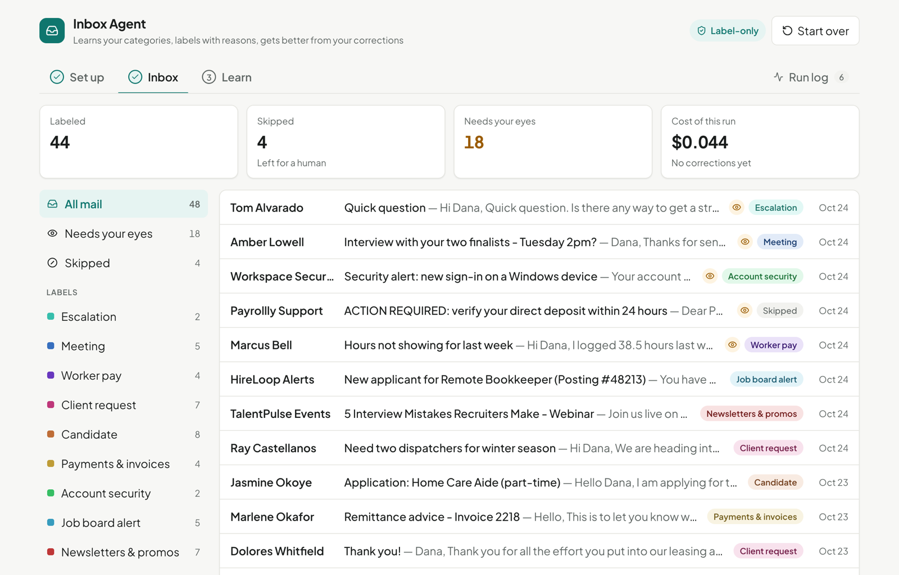
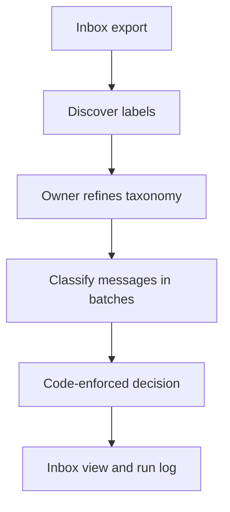
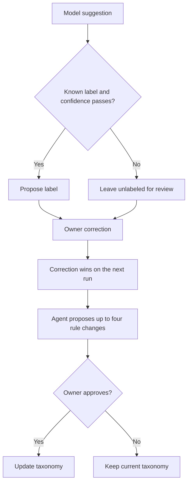
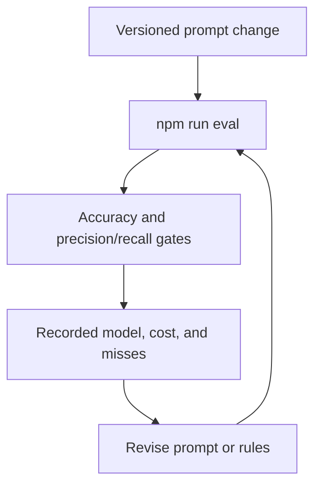
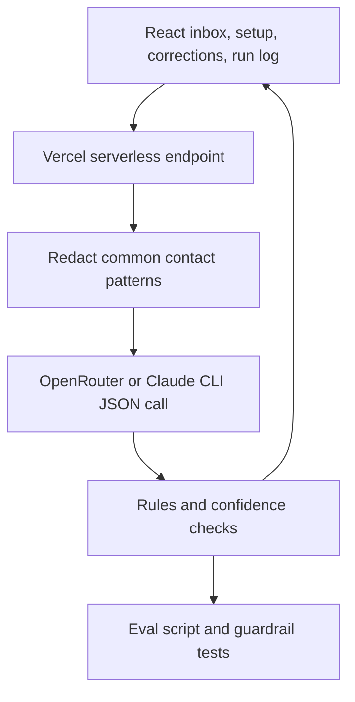

# Inbox Agent

Inbox Agent is an AI agent for inbox classification that I designed and built as an LLM workflow with versioned prompts and structured JSON output. Anyone can clone it, define a label taxonomy for their own inbox, and review the proposed taxonomy before the workflow uses it. It discovers categories from a sample, classifies email in batches, carries corrections into later runs, and keeps the only available action deliberately small: applying a label.

**[Try the live demo](https://inbox-agent-tan.vercel.app)**. The demo uses one fictional 49-email staffing-company inbox so visitors can inspect the full workflow without connecting an account or supplying a real mailbox.



## What this demonstrates

| Concept | How it is implemented | Where to look |
| --- | --- | --- |
| AI agent for inbox classification | Separate discovery, taxonomy refinement, classification, and rule-proposal stages turn an inbox into an owner-reviewed workflow. | [`lib/agent/agent.ts`](lib/agent/agent.ts) |
| Structured JSON output | One JSON-only model client records the task, model, prompt version, token use, cost, and duration for every call. | [`lib/agent/llm.ts`](lib/agent/llm.ts) |
| Human approval and code-enforced action boundaries | The owner approves taxonomy and rule changes; code rejects unknown labels and low-confidence results, and the action layer can produce labels only. | [`lib/agent/rules.ts`](lib/agent/rules.ts), [`src/App.tsx`](src/App.tsx) |
| Human-in-the-loop learning | A user correction overrides the model on the next run; proposed taxonomy changes require approval. | [`lib/agent/agent.ts`](lib/agent/agent.ts), [`docs/architecture.md`](docs/architecture.md) |
| LLM workflow with versioned prompts | Four evaluation gates check accuracy, high-stakes precision, and needs-your-eyes precision/recall on the 49-email fixture. | [`lib/agent/prompts.ts`](lib/agent/prompts.ts), [`scripts/eval.ts`](scripts/eval.ts) |
| Prompt-injection test | A fixture email embeds instructions to the model; the eval expects it not to become a client escalation and to be flagged for review. | [`data/demo-inbox.json`](data/demo-inbox.json), [`data/eval-set.json`](data/eval-set.json) |
| OpenRouter integration and Vercel serverless endpoint | One request boundary accepts the workflow action, forwards a visitor's key with that request, and makes structured JSON calls through OpenRouter using request-scoped server context. | [`api/agent.ts`](api/agent.ts), [`lib/agent/llm.ts`](lib/agent/llm.ts) |
| Privacy boundary | Common phone, email-address, and link patterns are redacted before model input. | [`lib/agent/redact.ts`](lib/agent/redact.ts), [`api/agent.ts`](api/agent.ts) |

## A run from inbox to review

1. I start by giving the agent an inbox export. It samples up to 100 messages and suggests categories, high-stakes labels, sender rules, and questions.
2. The owner can rename, merge, add, or prioritize categories in plain language. `cleanTaxonomy()` removes empty, duplicate, or invalid entries before they can be used.
3. The classifier sends messages to the model in batches of 12. The most recent 30 corrections become examples for that run.
4. The interface shows the label, reason, confidence, and any message needing attention. The owner can correct a result or approve a suggested change to the taxonomy.

### 1. Labeling pipeline



### 2. Guardrails and owner review



- Ordinary labels need at least 60% model confidence. High-stakes labels need 85%.
- A failed batch is retried once; a second failure leaves its messages for review.
- Sender rules do not bypass the urgency check. The model still decides whether ruled mail needs attention.
- The implementation exposes no archive, send, delete, or mark-read action. `toActions()` returns label actions only.

## Evaluation and regression checks

`npm run eval` classifies the complete 49-email test corpus against expected labels and fails when a gate is missed. The expected labels were AI-drafted, so the eval is a regression check for this corpus, not a benchmark of inbox intelligence.



| Check on 49 emails | Gemini 2.5 Flash | Claude Haiku | Gate |
| --- | ---: | ---: | ---: |
| Label accuracy | 100% | 94% | 80% |
| High-stakes precision | 9/9 | 6/6 | 95% |
| Needs-your-eyes recall | 19/21 (90%) | 21/21 (100%) | 80% |
| Needs-your-eyes precision | 19/20 (95%) | 21/23 (91%) | 60% |

The recorded Gemini run used five calls, took 21.055 seconds, and cost $0.0142. The eval found an urgency rule that first over-flagged messages; a replacement rule missed automated security alerts. Revising it raised sample urgency recall from 57% to 90%. The raw runs and misses are in [`docs/eval-results.md`](docs/eval-results.md).

## Architecture and implementation

The browser is a React 19 and Vite app. One Vercel serverless endpoint receives a request, redacts content, calls Gemini 2.5 Flash through OpenRouter for the live path, and returns structured output. A local Claude Code CLI path supports the comparison run.



## Run it with your own inbox data

```bash
npm install
cp .env.example .env.local
npm run dev
npm run eval
npm test
```

Set an OpenRouter key in `.env.local`, or use `LLM_PROVIDER=claude-cli` for the local comparison path. Use only mailbox data you are permitted to process.

## Repository map

| Path | Purpose |
| --- | --- |
| [`src/`](src/) | React inbox, setup, correction, and run-log screens |
| [`api/agent.ts`](api/agent.ts) | Request boundary and action router |
| [`lib/agent/`](lib/agent/) | Prompts, model client, redaction, taxonomy rules, and types |
| [`data/`](data/) | Demo inbox, expected labels, and a recorded sample run |
| [`scripts/`](scripts/) | Eval and focused guardrail tests |
| [`docs/`](docs/) | Architecture, screenshots, and raw evaluation output |

## Current status

- The app is not connected to Gmail. Gmail access, scheduling, and delivery of a morning report are future work.
- Redaction covers common phone, email-address, and link patterns. Names and sender domains can remain for classification.
- Confidence thresholds are product choices, not calibrated probabilities.

## Ownership

I designed the system and architecture and directed the implementation.

MIT License.
