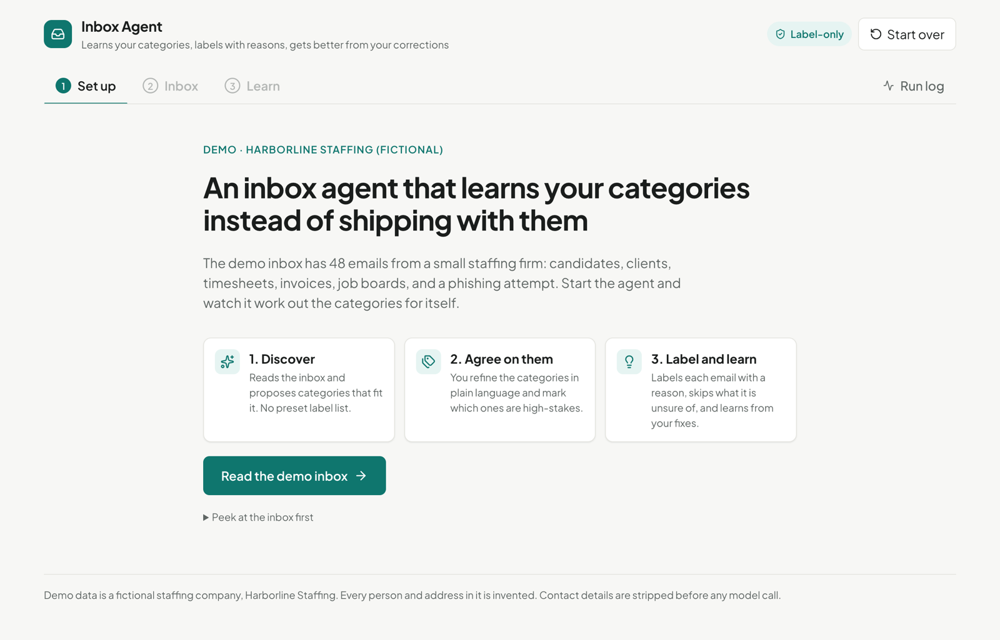
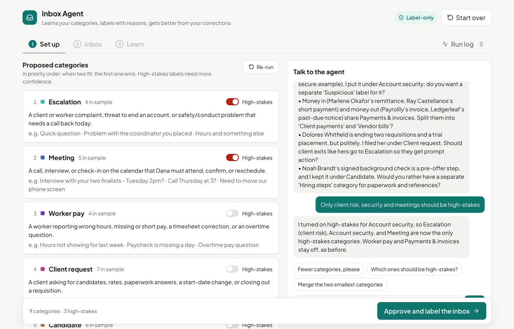
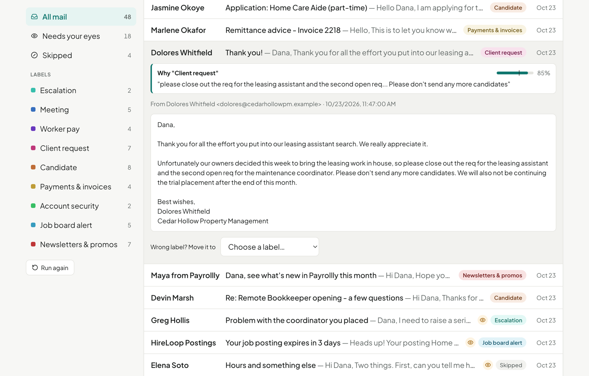
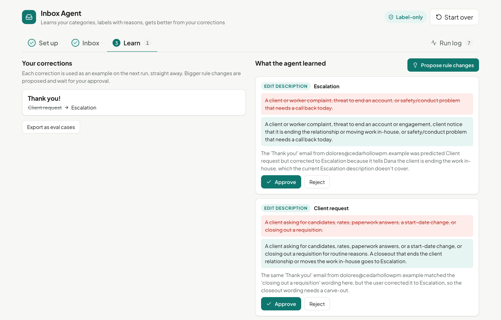
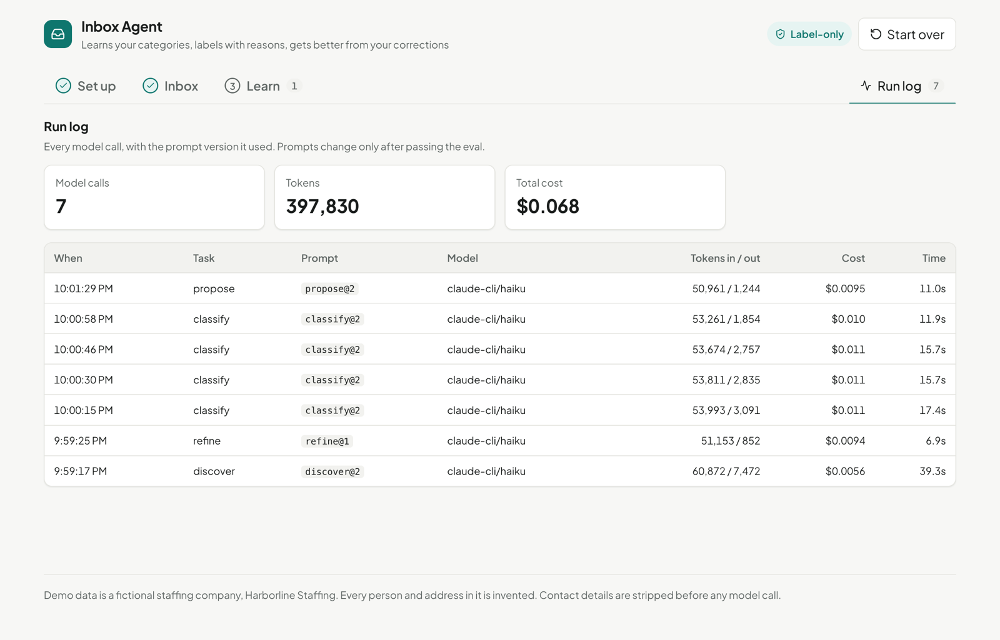

# Inbox Agent

An email triage agent that learns your inbox instead of shipping with fixed labels. It reads a sample of your mail, proposes categories, refines them with you in plain language, then labels every email with a reason, skips what it isn't sure of, and learns from your corrections.

It grew out of a labeling agent I run on my own Gmail every morning. That one has hard-coded rules for a job search. This one keeps the lessons and lets the categories come from the inbox.

**Label-only by design.** It never archives, sends, deletes or marks anything read. Those actions don't exist in the code.

## How it works

1. **Discover.** Reads the inbox and proposes 6–10 categories in priority order, marks the rare, action-triggering ones as high-stakes, and asks where it was unsure.
2. **Onboard.** You talk to it: "merge these two", "anything from @client.com goes to Client Requests", "only escalations are high-stakes".
3. **Label.** One label per email, the decisive sentence as the reason, a confidence score, and a short "Needs your eyes" list.
4. **Learn.** Corrections are used as examples on the next run. The agent also proposes rule changes, and nothing changes until you approve.

Design rules and the full loop: [docs/architecture.md](docs/architecture.md).

## Walkthrough

One real run on the demo inbox. Nothing below is staged: the categories, labels, reasons and proposals are what the agent produced.

**1. Start.** No label list to configure. The agent starts by reading the inbox.



**2. Set up.** It proposed nine categories for this staffing inbox, in priority order, and asked where it wasn't sure, such as a lookalike payroll domain or a client politely closing two roles. I told it which categories should be high-stakes, and it changed exactly that.



**3. Label.** Each email gets one label or a skip. The phishing email and an email that mixed a pay question with a complaint were left for a human. Anything urgent goes to a short "Needs your eyes" list.


**4. Check its reasoning.** Every label quotes the sentence it was based on and shows its confidence against that label's threshold. This one is wrong: the client is ending the work, so it belongs in Escalation. One dropdown fixes it.



**5. Learn.** The correction is used as an example on the next run straight away. The agent also proposed two description changes, shown as before and after, and neither applies until approved.



**6. Run log.** Every model call, with the prompt version, tokens, cost and time.



*These screenshots come from a local run through the Claude Code CLI dev provider (`LLM_PROVIDER=claude-cli`). Its input token counts include the CLI's own cached context, so they overstate the agent's prompts.*

## Eval

```
Inbox agent eval — 48 emails, classify@2
  Accuracy                  94%   (gate 80%)
  High-stakes precision    100%   (gate 95%)
  Needs-your-eyes recall    90%   (gate 80%)
  Needs-your-eyes precision 95%   (gate 60%)
```

Run against a fictional staffing-company inbox (`data/demo-inbox.json`) with a hand-labeled answer key (`data/eval-set.json`), including traps like a "Thank you!" email that is actually a cancellation and a phishing message from a lookalike payroll domain. Every prompt change is versioned and re-run through `npm run eval` before it ships.

## Run it

```bash
npm install
cp .env.example .env.local   # add your OpenRouter key
npm run dev                  # http://localhost:5173
```

| Command | Purpose |
|---|---|
| `npm run dev` | App and API together |
| `npm run eval` | Score the classifier against the answer key |
| `npm test` | Redaction and guardrail checks |
| `npm run build` | Type-check and build |

Any OpenRouter model works (`OPENROUTER_MODEL`). The demo inbox is fictional: every person, company and address in it is invented.

## Make it yours

- Replace `data/demo-inbox.json` with your own export (same shape: `id`, `from`, `date`, `subject`, `body`) and run Discover. No label list to edit.
- Tune the confidence bars in `lib/agent/rules.ts`.
- Prompts live in `lib/agent/prompts.ts`. Bump the version and run the eval after any change.

## Layout

| Path | Contents |
|---|---|
| `lib/agent/agent.ts` | Discover, refine, classify, propose |
| `lib/agent/rules.ts` | Pure rules: sender rules, confidence bars, label-only actions |
| `lib/agent/prompts.ts` | Versioned prompts |
| `lib/agent/redact.ts` | Strips contact details before any model call |
| `lib/agent/llm.ts` | OpenRouter call, JSON parsing, run log |
| `api/agent.ts` | The one serverless endpoint |
| `src/` | React UI |
| `scripts/` | Eval and self-checks |
