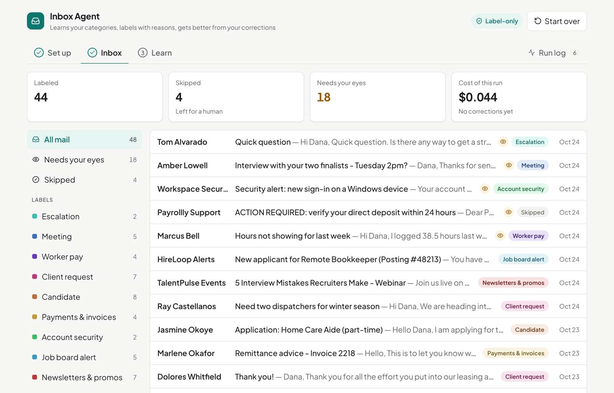

# Inbox Agent

Sorts email into labels that fit your inbox, and learns from your fixes. It only adds labels. It never archives, sends or deletes.

This is a web version of the labeling agent I run on my own Gmail every morning. Mine has labels hard-coded for a job search. This one reads the inbox first and suggests its own, so it works for any inbox. The demo runs on 49 made-up emails from a small staffing company.

## How it works

1. It reads the inbox and suggests labels.
2. You adjust them by asking in plain words.
3. It labels every email and says why. Anything it isn't sure about stays unlabeled for you.
4. When you fix a label, it uses that fix next time. If it wants to change a rule, it asks first.



More screenshots: [suggested labels](docs/screenshots/2-setup.png), [why it chose a label](docs/screenshots/4-email-detail.png), [a suggested change after a fix](docs/screenshots/5-learn.png).

## Try it

Open the [demo](https://inbox-agent-tan.vercel.app) and press **See a recorded run** to look around without a key. To run it live, add your own [OpenRouter key](https://openrouter.ai/keys) under **AI key**. The key stays in your browser and is only sent with your own requests.

## Status

Working prototype. The live demo uses Gemini 2.5 Flash through OpenRouter. Not connected to Gmail yet.

## Test results

49 made-up emails, with expected labels drafted by AI. One of them tries to tell the agent how to label it. Run it with `npm run eval`.

| Check | Gemini 2.5 Flash | Claude Haiku | Must be at least |
|---|---|---|---|
| Correct label | 100% | 94% | 80% |
| Important labels that were right | 100% (9 of 9) | 100% (5 of 5) | 95% |
| Urgent emails it flagged | 90% | 95% | 80% |
| Flags that were really urgent | 100% | 95% | 60% |

Gemini through OpenRouter (two runs, same result, about $0.01 each) and Haiku through the Claude Code CLI. The sample is small, so treat these as a smoke test, not a benchmark.

Two things the eval caught. The first version flagged 32 of 48 emails as urgent, so I added the last check. Then a rule I wrote to fix that made Gemini skip automated alerts, like a sign-in warning, and recall dropped to 57%. Rewriting the rule brought it back to 90%.

## What's next

Not built yet: run it on a daily schedule against a real inbox, and post the report where the team already works, like Slack. Set it up once, and it runs every morning and gets better with each correction.

## Run it

```bash
npm install
cp .env.example .env.local   # add an OpenRouter key, or set LLM_PROVIDER=claude-cli
npm run dev
```

## Layout

| Path | Contents |
|---|---|
| `lib/agent/` | The agent: prompts, rules, and the AI call |
| `api/agent.ts` | The one server endpoint |
| `src/` | The web app |
| `data/` | Demo emails and expected labels |
| `scripts/` | Tests, eval, and the script that records the sample run |
| `docs/architecture.md` | How it's built |
