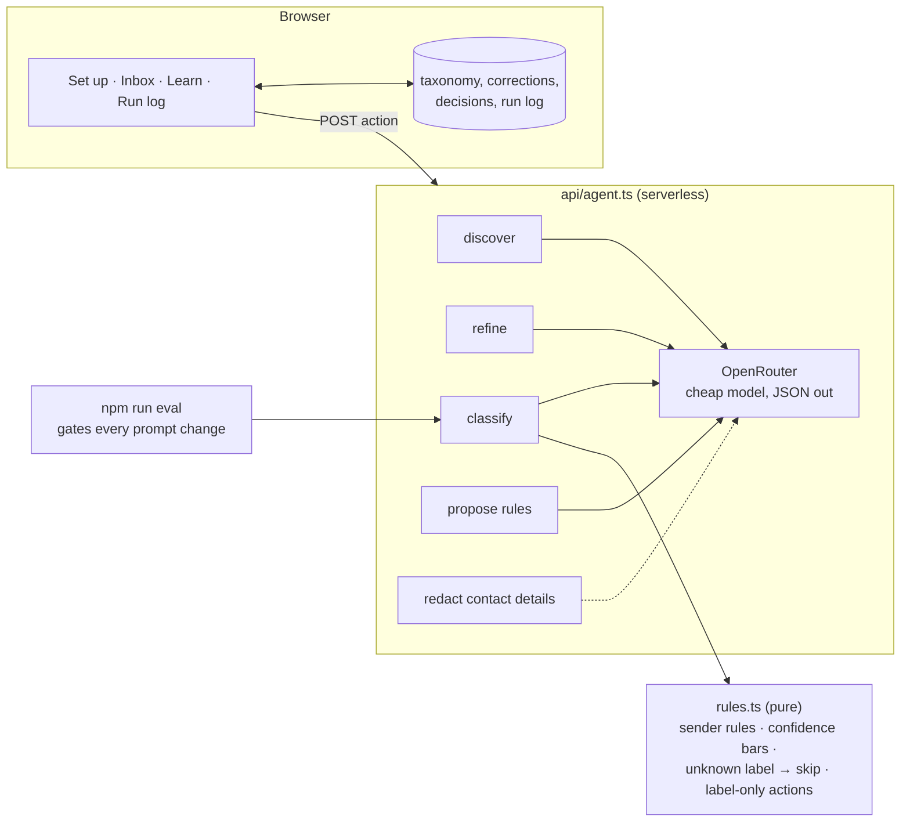

# Architecture

The inbox agent started as a scheduled Claude task that labels my own Gmail every morning. Its rules were a fixed decision tree written for a job search. This version keeps the lessons from that tree and drops the fixed labels, so the same agent works for any inbox.

## The loop

| Step | What happens | Who decides |
|---|---|---|
| 0 · Discover | Reads up to 100 emails, proposes 6–10 categories in priority order, marks the rare action-triggering ones high-stakes, asks where it was unsure | Agent proposes |
| Onboard | The user renames, merges, splits, reorders, marks high-stakes or adds sender rules in plain language | User |
| Approve | Categories become the label set | User |
| Classify | One label per email or a skip, with the decisive sentence as the reason, and a short "Needs your eyes" list | Agent suggests, code enforces |
| Correct | The user fixes a label. The correction is used as an example on the next run straight away | User |
| Learn | The agent reads the corrections and proposes rule changes. Nothing changes until approved | Agent proposes, user approves |

## Design rules

1. **One agent, few tools.** Four actions, one endpoint. No sub-agents until one agent gets confused.
2. **Labeling is the only write.** `toActions()` can only produce `{ type: 'label' }`. Archive, send, delete and mark-read do not exist in the code, so a prompt cannot reach them. A wrong label is visible and costs seconds. A wrong archive is invisible.
3. **The model suggests; code decides.** `enforce()` turns unknown labels and low confidence into skips. High-stakes categories need 0.85 confidence, others 0.6. A skip is a good outcome.
4. **Sender rules run before the model.** Unconditional, deterministic, free.
5. **Contact details never reach the model.** Emails, phone numbers and links are stripped; sender addresses are reduced to their domain unless they are clearly automated.
6. **Every prompt change goes through the eval.** Prompts carry versions. `npm run eval` scores accuracy, high-stakes precision, and needs-your-eyes recall and precision, and exits non-zero below the gate.
7. **Everything is logged.** Each model call records task, model, prompt version, tokens, cost and time.
8. **AI proposes, the user decides.** Corrections apply as examples immediately. Rule changes wait for approval.

## Lessons carried over from the original agent

- Read the body, not the subject. "Thank you!" was a client cancelling two roles.
- A keyword is not a category. A webinar called "5 Interview Mistakes" is marketing.
- A sender domain is not a classifier, and `noreply` can still be important.
- Rare labels are fragile. One wrong entry and the user stops trusting the label, so they get a higher bar.

## What the eval caught

The first version of the classify prompt flagged 32 of 48 demo emails as "Needs your eyes". Recall looked fine; the queue was useless. Adding a precision gate exposed it, and `classify@2` brought precision from about 56% to 95% while accuracy rose from 90% to 94%.

## Not built yet

- Gmail mode (OAuth, read and label only).
- A shared daily spend cap for the public demo.
- An MCP server so other agents can call it. Deliberately last.
