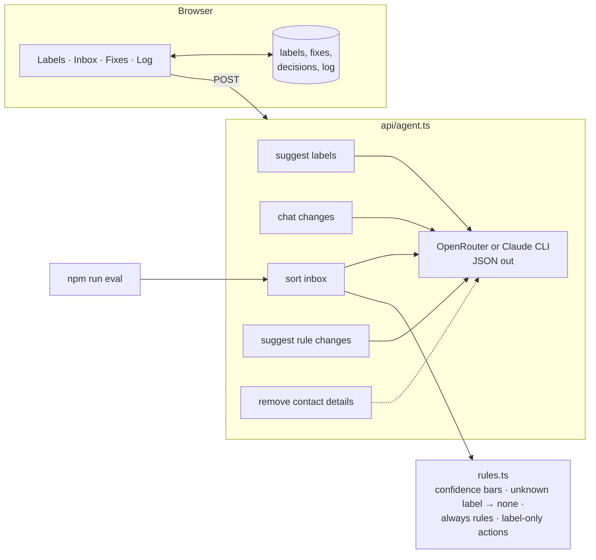

# How it's built

The agent started as a scheduled Claude task that labels my own Gmail every morning. Its rules were written for a job search. This version keeps the rules that worked and drops the fixed labels.

## The loop

| Step | What happens | Who decides |
|---|---|---|
| Suggest | Reads up to 100 emails and proposes 6 to 10 labels in priority order, marks the important ones, and asks where it was unsure | Agent |
| Adjust | The user renames, merges, reorders or adds labels in plain words | User |
| Sort | One label per email, or none, with the sentence it was based on. Urgent emails are flagged | Agent suggests, code enforces |
| Fix | The user changes a label. That email keeps the new label, and the fix is used as an example next time | User |
| Learn | The agent reads the fixes and suggests rule changes. Nothing changes until the user approves | Agent suggests, user approves |

## Rules the code enforces

1. **Labeling is the only action.** `toActions()` in [`rules.ts`](../lib/agent/rules.ts) can only produce a label. Archive, send and delete don't exist.
2. **Code checks every answer.** `enforce()` turns unknown labels and low confidence into "no label." Important labels need 85% confidence, the rest 60%.
3. **Fixes win.** A label the user set is applied before the model runs and is never overwritten.
4. **"Always" rules set the label, not the urgency.** Mail from a sender with an always rule still goes to the model, so it can be flagged as urgent. The agent only proposes an always rule when every sample email from that sender got the same label.
5. **Contact details never reach the model.** Phone numbers, email addresses and links are removed first.
6. **A failed call doesn't stop the run.** A batch that fails is retried once, then left unlabeled and flagged.
7. **Every prompt has a version.** Prompts live in [`prompts.ts`](../lib/agent/prompts.ts), and any change is re-run through `npm run eval` before it ships.

## Rules carried over from my own agent

- Read the body, not the subject. A "Thank you!" email turned out to be a client cancelling two roles.
- A keyword is not a category. A webinar called "5 Interview Mistakes" is marketing.
- A sender's domain doesn't decide the label. The same client can complain one day and ask for a new hire the next.
- Rare labels need a higher bar. One wrong entry and people stop trusting the label.
